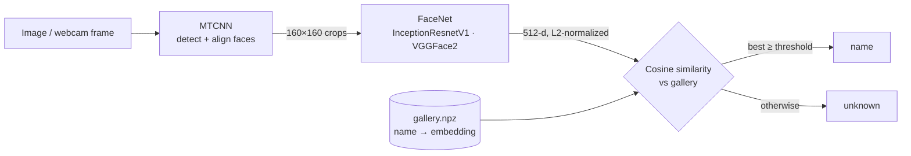

# Face Recognition with Embeddings

Recognize people from a photo or a live webcam feed by comparing **FaceNet
embeddings**. You register a person once from a single photo. No classifier is
trained, so adding someone new takes one command and no retraining.

```bash
python main.py register "Alice" photos/alice.jpg
python main.py identify group_photo.jpg
# alice           similarity=0.83  box=[412, 96, 518, 231]
# unknown         similarity=0.31  box=[120, 140, 210, 262]
python main.py live        # webcam, labels each face in real time
```

## How it works



1. **Detect and align.** MTCNN, a three-stage cascaded CNN, finds every face
   and returns aligned 160×160 crops normalized the way FaceNet expects.
2. **Embed.** FaceNet (InceptionResnetV1, pretrained on VGGFace2) maps each
   face to a 512-dimensional vector. It was trained with a metric-learning
   objective, so photos of the same person land close together and different
   people land far apart.
3. **Match.** Embeddings are L2-normalized, so cosine similarity is just a dot
   product. The probe is compared with every gallery entry in one matrix
   multiply. The best score has to clear a **threshold** (default `0.7`) or the
   face is reported as `unknown`. This open-set check is what stops the system
   from labelling a stranger as the closest registered person.

### Why embeddings instead of a classifier?

A classifier has to be retrained every time someone is added and needs many
images per person. With an embedding model, registering a person is just
storing one vector: one-shot learning. That is the same approach used by
production face-unlock and photo-tagging systems.

### Choosing the threshold

The threshold trades **false accepts** (a stranger is matched) against **false
rejects** (a registered person isn't recognized). Raise it for security uses,
lower it for convenience, e.g. `--threshold 0.6`. Registering 2–3 photos per
person, under different lighting and angles, makes matching much more robust.

## Quickstart

```bash
git clone git@github.com:hsoni0303/Face_Recognition_with_Embeddings.git
cd Face_Recognition_with_Embeddings
python -m venv .venv && source .venv/bin/activate
pip install -r requirements.txt

python main.py register "Your Name" --camera
python main.py live
```

## Project structure

```
├── face_id.py             # FaceEncoder (MTCNN + FaceNet) and Gallery (match, save/load)
├── main.py                # CLI: register / identify / live
└── tests/test_gallery.py  # matching, open-set rejection, persistence
```

Run the tests with `pytest -q`. They exercise the matching logic and don't need
the model weights.

## Limitations

- **Privacy:** `gallery.npz` holds biometric data and is git-ignored. Don't
  commit it.
- **Liveness:** a printed photo of a registered person will match. Real
  access-control systems add liveness or anti-spoofing checks.
- **Scale:** brute-force search is fine for hundreds of identities. For
  millions, use an approximate nearest-neighbour index such as FAISS.
